# DeDotAI (DeWatermark) 🛡️🎨

<div align="center">

**Erase Visible Watermarks & Neutralize Invisible AI Watermarks (Google SynthID) — 100% Client-Side.**

*A high-performance, private, browser-native image restoration suite powered by WebGPU, ONNX Runtime Web, 8x8 Block-DCT Spectral Filtering, and Classical Computer Vision. Zero server uploads. Zero tracking.*

[](https://nextjs.org/)
[](https://react.dev/)
[](https://www.typescriptlang.org/)
[](https://tailwindcss.com/)
[](https://onnxruntime.ai/)
[](https://www.w3.org/TR/webgpu/)
[](#privacy--security-guarantee)
[](LICENSE)

</div>

---

## 📌 সূচিপত্র / Table of Contents

1. [Overview / পরিচিতি](#-overview--পরিচিতি)
2. [Key Capabilities & Dual Engines](#-key-capabilities--dual-engines)
3. [How It Works: Technical Deep Dive](#-how-it-works-technical-deep-dive)
   - [Engine 1: Precision SynthID & Deep AI Watermark Neutralizer](#1-precision-synthid--deep-ai-watermark-neutralizer)
   - [Engine 2: Visual Watermark Detection & Inpainting](#2-visual-watermark-detection--inpainting)
4. [Architecture Pipeline](#-architecture-pipeline)
5. [Project Structure](#-project-structure)
6. [Tech Stack](#-tech-stack)
7. [Getting Started & Local Setup](#-getting-started--local-setup)
8. [User Guide / কীভাবে ব্যবহার করবেন](#-user-guide--কীভাবে-ব্যবহার-করবেন)
9. [Optional Deep Learning Models (LaMa & U²-Net)](#-optional-deep-learning-models)
10. [Browser Compatibility & Hardware Acceleration](#-browser-compatibility)
11. [Privacy & Security Guarantee](#-privacy--security-guarantee)
12. [License & Disclaimer](#-license--disclaimer)

---

## 🌟 Overview / পরিচিতি

**DeDotAI** হলো একটি কাটিং-এজ ব্রাউজার-ফার্স্ট (Browser-First) ওয়েব অ্যাপ্লিকেশান, যা একই সাথে দুটি বড় সমস্যার সমাধান করে:

1. **ইন্টারনেটে ছড়িয়ে থাকা ছবির দৃশ্যমান ওয়াটারমার্ক (Visible Watermarks):** কোনো স্টক লোগো, ক্যামেরার তারিখ/টাইমস্ট্যাম্প, টেক্সট বা গ্রাফিক মার্ক মুছে ফেলা।
2. **অদৃশ্য এআই ওয়াটারমার্ক (Google DeepMind SynthID & Latent AI Signatures):** জেনারেটিভ এআই মডেল (যেমন Google Imagen 3, Gemini, Vertex AI, Stable Diffusion, StegaStamp) যে সূক্ষ্ম অদৃশ্য ফ্রিকোয়েন্সি সিগনেচার বা ওয়াটারমার্ক ছবির পিক্সেলের ভেতর ঢুকিয়ে দেয়, সেগুলোকে ছবি নষ্ট না করে ও টেক্সট ব্লার না করে পুরোপুরি নিউট্রালাইজ (Neutralize/Purge) করা।

সবচেয়ে গুরুত্বপূর্ণ বিষয়: **সম্পূর্ণ প্রসেসিং আপনার নিজস্ব ডিভাইসে (ল্যাপটপ বা মোবাইলের ব্রাউজারে) চলে। কোনো সার্ভারে ছবি আপলোড হয় না (Zero Network Uploads)।**

```
+---------------------------------------------------------------------------------------------------+
|                                        DeDotAI WORKSPACE                                         |
+---------------------------------------------------------------------------------------------------+
|  [Select Image]  |  [Mode: SynthID AI Cleaner / Visual Eraser]  |  [Compare Slider]  |  [Export]  |
|---------------------------------------------------------------------------------------------------|
|                                                                                                   |
|     +-----------------------------------------+-----------------------------------------+         |
|     |                                         |                                         |         |
|     |             ORIGINAL IMAGE              |            CLEANSED IMAGE               |         |
|     |  • Active SynthID High-Freq Carrier     |  • SynthID Purged (0% Carrier Detected) |         |
|     |  • Visible Corner / Center Watermark    |  • Seamless Background Inpainted        |         |
|     |                                         |  • STEP Sharp Typography Preserved      |         |
|     |                                         |                                         |         |
|     +-----------------------------------------+-----------------------------------------+         |
|                                           <---|--->                                               |
|                                     [Interactive Split Slider]                                    |
|                                                                                                   |
+---------------------------------------------------------------------------------------------------+
```

---

## ⚡ Key Capabilities & Dual Engines

### 1. 🛡️ Invisible AI Watermark Neutralizer (DeDotAI Engine)
* **Google DeepMind SynthID Stripping**: Imagen 3, Gemini, Vertex AI ওয়াটারমার্কের বিরুদ্ধে বিশেষভাবে অপ্টিমাইজড।
* **100% Rigid Geometry (dx = 0, dy = 0)**: ছবিতে কোনো ওয়ার্পিং (Warping), বাঁকানো বা জ্যামিতিক বিকৃতি ঘটে না।
* **STEP (Selective Text & Edge Protection)**: টেক্সট, কোড বা ফাইন ডিটেল ব্লার হওয়া থেকে রক্ষা পায় এবং আল্ট্রা-শার্প থাকে।
* **Live Carrier Diagnostic**: প্রসেসিংয়ের আগে ও পরে ক্যারিয়ার সিগন্যালের তীব্রতা (Carrier Score & Detection Status) তাৎক্ষণিক অ্যানালাইসিস।

### 2. 🖌️ Visual Watermark Eraser & Inpainter
* **Sobel + Spatial Heuristic Auto-Detection**: এক ক্লিকে কোণায় বা মার্জিনে থাকা লোগো ও টেক্সট স্বয়ংক্রিয়ভাবে ডিটেক্ট করে মাস্ক তৈরি।
* **Manual Precision Masking**: ব্রাশ (Brush) এবং ইরেজার (Eraser), রেডিয়াস ও ওপাসিটি অ্যাডজাস্টমেন্ট, আনডু/রিডু হিস্ট্রি।
* **Classical Fast Inpainting**: কোনো মডেল ডাউনলোড ছাড়াই তাৎক্ষণিক Telea/Navier-Stokes হাইব্রিড বাউন্ডারি ডিফিউশন।
* **Neural LaMa Inpainting (Optional)**: WebGPU/WASM ব্যাকএন্ডের মাধ্যমে ডিপ লার্নিং LaMa মডেল দিয়ে জটিল টেক্সচার ইনপেইন্ট।

### 3. 🚀 Client-Side Performance & UX
* **WebGPU & WASM SIMD**: আধুনিক ব্রাউজারে হার্ডওয়্যার অ্যাকসিলারেটেড গ্রাফিক্স কম্পিউট।
* **Interactive Before/After Slider**: মাউস ড্র্যাগ করে অরিজিনাল বনাম ক্লিন রেজাল্ট দেখার সুবিধা।
* **Lossless/Quality Export**: PNG, JPEG, WebP ফরম্যাটে এক্সপোর্ট ও স্বয়ংক্রিয় এক্সিফ/মেটাডেটা স্ক্রাবিং।

---

## 🔬 How It Works: Technical Deep Dive

কীভাবে পুরো অ্যালগরিদম কাজ করে তার বিস্তারিত টেকনিক্যাল ব্যাখ্যা:

### 1. Precision SynthID & Deep AI Watermark Neutralizer

Google SynthID ও অন্যান্য অদৃশ্য এআই ওয়াটারমার্ক সাধারণ মানুষের চোখে ধরা পড়ে না কারণ সেগুলো পিক্সেলের কালার ভ্যালু সামান্য পরিবর্তন করে উচ্চ-ফ্রিকোয়েন্সি (High Frequency AC) ব্যান্ডে একটি সুনির্দিষ্ট 136-বিট কোভেরিয়েন্স প্যাটার্ন তৈরি করে। SynthID সবচেয়ে বেশি ক্যারিয়ার এনার্জি রাখে **সবুজ (Green) চ্যানেলে**।

DeDotAI নিচের ৬টি ধাপে এই ক্যারিয়ার ধ্বংস করে:

```
[Input RGB Image]
       │
       ├─► 1. Rigid Coordinate Channel Extraction (R, G, B, Alpha)
       │
       ├─► 2. Scharr Operator & Gradient Salience Analysis
       │      └─ টেক্সট ও হাই-কনট্রাস্ট এজ আলাদা করে চিহ্নিত করা (Edge Mask)
       │
       ├─► 3. Multi-Channel Bilateral Surface Filter (Green Channel Focused)
       │      └─ টেক্সট এজ অক্ষত রেখে মাইক্রো-ভ্যারিয়েন্স ক্যারিয়ার ফিল্টার
       │
       ├─► 4. Dead-Zone Residual Carrier Nulling & Stochastic Dithering
       │      └─ R_residual = C - C_base; ক্যারিয়ার থ্রেশহোল্ডের নিচে সিগন্যাল শূন্য করা
       │
       ├─► 5. 8x8 Block-DCT Adaptive Frequency Quantization
       │      └─ AC Bands (Orders 2 to 9) এর ফেজ কোভেরিয়েন্স ভেঙে দেওয়া
       │
       └─► 6. STEP Precision Unsharp Masking (Typography Boost)
              └─ ফন্ট ও কোডের আউটলাইনকে ১০০% ক্রিস্প ও শার্প করে আউটপুট তৈরি
```

#### মূল অ্যালগরিদম উপাদান:
* **Scharr Operator Gradient Map**: প্রতিটি পিক্সেলের গ্রেডিয়েন্ট মেপে নিশ্চিত করা হয় কোনগুলো লেখার প্রান্ত (Typography Edge) এবং কোনগুলো ফ্ল্যাট ব্যাকগ্রাউন্ড।
* **Green-Weighted Bilateral Filter**: গ্রিন চ্যানেলে ক্যারিয়ার বেশি থাকায় $1.15\times$ বেশি রেঞ্জ সিগমা দিয়ে ফিল্টার করা হয়, যা টেক্সট বাদ দিয়ে ক্যারিয়ার স্মুথ করে।
* **Residual Dead-Zone Stripping**: $R_c = C - C_{\text{base}}$ ক্যালকুলেট করে কম অ্যাম্প্লিটিউডের সিগন্যালগুলোকে ডেড-জোন থ্রেশহোল্ডিং দ্বারা ফেলে দেওয়া হয়।
* **8x8 Block DCT Quantization**: প্রতি $8\times 8$ ব্লকে Discrete Cosine Transform চালিয়ে AC ক্যারিয়ার ফ্রিকোয়েন্সি $u+v \in [2, 9]$ ব্যান্ডের ডেসিমেল মানগুলোকে স্টোকাস্টিক কোয়ান্টাইজেশনের মাধ্যমে নিরপেক্ষ করে দেওয়া হয়।
* **STEP High-Pass Sharpening**: লাপ্লাসিয়ান ও ক্যাটমুল-রম হাই-পাস ফিল্টার দিয়ে টেক্সটের পিক্সেলগুলোকে আল্ট্রা-শার্প কন্ট্রাস্ট দেওয়া হয়।

---

### 2. Visual Watermark Detection & Inpainting

```
[Input Image] ──► [Grayscale] ──► [Sobel Filter] ──► [Spatial Margin Weighting]
                                                              │
                                                              ▼
                                                   [Threshold & Dilation]
                                                              │
                                                              ▼
                                                    [Binary Inpaint Mask]
```

1. **Spatial Corner Weighting**: লোগো ও ওয়াটারমার্ক সাধারণত ছবির মাঝখানে থাকে না, বরং চার কোণায় বা মার্জিনে থাকে। তাই বটম-রাইট/লেফট কর্নারকে সর্বোচ্চ ওয়েইট ($1.0$), টপ মার্জিনকে ($0.85$), এবং সেন্টারকে সর্বনিম্ন ওয়েইট ($0.05$) দিয়ে ফলস-পজিটিভ রোধ করা হয়।
2. **Morphological Dilation**: অক্ষরের ভাঙা রেখা জোড়া লাগাতে ২-পিক্সেল রেডিয়াসে ডাইলেশন চালানো হয়।
3. **Classical Hybrid Inpainting**:
   - মাস্ক করা অজানা পিক্সেলগুলোর সীমানা (Frontier) ট্র্যাক করা হয়।
   - চারপাশের পরিচিত পিক্সেল থেকে ডিস্ট্যান্স-ওয়েইটেড ও গ্রেডিয়েন্ট-ডিরেক্টেড কালার ডিফিউশন করা হয়।
   - লোকাল টেক্সচার ভ্যারিয়েন্স মেপে হালকা মাইক্রো-গ্রেইন যোগ করা হয়, যাতে ইনপেইন্টেড জায়গা মসৃণ প্লাস্টিকের মতো না দেখায়।
4. **Deep Neural Inpainting (LaMa via ONNX)**:
   - বড় লোগোর জন্য LaMa মডেল ছবির $512\times 512$ টাইলস তৈরি করে এবং WebGPU ব্যাকএন্ডে নিউরাল নেটওয়ার্কের মাধ্যমে টেক্সচার পুনর্নির্মাণ করে।

---

## 🏗️ Architecture Pipeline

```mermaid
flowchart TD
    subgraph Client [Client-Side Browser Execution - 100% On-Device]
        Upload["Input Image (Drag & Drop / Paste)"] --> Loader["HTML Canvas Pixel Extractor"]
        
        Loader --> ModeSelect{"Select Workflow"}
        
        %% Workflow 1: SynthID AI Neutralizer
        ModeSelect -->|Engine 1: SynthID Mode| Diag["Carrier Diagnostic Analyzer"]
        Diag --> Scharr["Scharr Edge Gradient Salience"]
        Scharr --> Bilateral["Green-Channel Bilateral Suppression"]
        Bilateral --> Residual["Dead-Zone Residual Nulling"]
        Residual --> DCT["8x8 Block-DCT AC Quantization"]
        DCT --> STEP["STEP Precision Typography Boost"]
        STEP --> CleanResult["Neutralized & Sharpened Result"]
        
        %% Workflow 2: Visual Eraser
        ModeSelect -->|Engine 2: Visual Eraser| MaskStudio["Mask Studio (Brush / Eraser / Auto-Detect)"]
        MaskStudio --> EngineRouter{"Inpainting Engine"}
        
        EngineRouter -->|Built-in / Fast| Classical["Classical CV Frontier Inpainting + Grain Synthesis"]
        EngineRouter -->|Hardware AI| ONNX["ONNX Runtime Web (WebGPU / WASM SIMD)"]
        ONNX --> LaMa["LaMa Neural Inpainting"]
        
        Classical --> Blend["Edge Blending & Seam Smoothing"]
        LaMa --> Blend
        Blend --> CleanResult
        
        %% Output & Comparison
        CleanResult --> Slider["Interactive Split-Screen Comparison View"]
        Slider --> Export["Sanitized Canvas Export (PNG / JPG / WebP)"]
    end
```



---

## 📁 Project Structure

```
dedotai/
├── public/
│   └── models/                      # ঐচ্ছিক ডিপ লার্নিং ONNX মডেল (LaMa / U2Net)
├── src/
│   ├── app/
│   │   ├── layout.tsx               # রুট লেআউট, মেটাডেটা ও থিম কনটেক্সট
│   │   ├── page.tsx                 # মূল ল্যান্ডিং ও ওয়ার্কস্পেস স্টেট হ্যান্ডলার
│   │   └── globals.css              # টেইলউইন্ড সিএসএস স্টাইল
│   ├── components/
│   │   ├── LandingHero.tsx          # প্রিমিয়াম ল্যান্ডিং হিরো সেকশন
│   │   ├── Header.tsx               # টপ ন্যাভবার ও ব্রাউজার স্ট্যাটাস
│   │   ├── ImageUploader.tsx        # ড্র্যাগ-অ্যান্ড-ড্রপ, ফাইল ভ্যালিডেশন
│   │   ├── ImageWorkspace.tsx       # ফুল-ফিচার্ড ইন্টারঅ্যাক্টিভ এডিটিং ওয়ার্কস্পেস
│   │   ├── MaskToolbar.tsx          # ব্রাশ, ইরেজার, সাইজ, অপাসিটি ও আনডু টুলস
│   │   ├── MaskEditor.tsx           # ক্যানভাস মাস্ক ড্রয়িং ও প্যান/জুম ভিউয়ার
│   │   ├── BeforeAfterSlider.tsx    # রিয়েল-টাইম স্প্লিট স্লাইডার কম্প্যারিজন
│   │   ├── ExportControls.tsx       # ফরম্যাট (PNG/JPG/WebP) ও কোয়ালিটি সেটিংস
│   │   ├── PrivacyBadge.tsx         # অন-ডিভাইস লোকাল প্রসেসিং ব্যাজ
│   │   └── StatusIndicator.tsx      # WebGPU / WASM অ্যাক্টিভেশন স্ট্যাটাস
│   ├── hooks/
│   │   ├── useCapabilities.ts       # ব্রাউজারের হার্ডওয়্যার ডিটেকশন হুক
│   │   └── useImageLoader.ts        # ইমেজ লোডিং ও ডাইমেনশন স্কেলিং
│   ├── lib/
│   │   ├── canvas/
│   │   │   └── utils.ts             # ক্যানভাস স্কেলিং ও ইমেজ-ডাটা ইউটিলিটি
│   │   ├── detection/
│   │   │   └── classical-detection.ts # সোবেল এজ ও কর্নার-ওয়েইটেড ওয়াটারমার্ক ডিটেকশন
│   │   ├── export/
│   │   │   └── export.ts            # ইমেজ এক্সপোর্ট, মেটাডেটা রিমুভাল ও ডাউনলোড
│   │   ├── image/
│   │   │   ├── synthid-neutralizer.ts # SOTA SynthID ও এআই ওয়াটারমার্ক নিউট্রালাইজার
│   │   │   ├── preprocessing.ts     # টেনসর নরমালাইজেশন ও রিসাইজিং
│   │   │   ├── postprocessing.ts    # ব্লেন্ডিং ও পোস্ট-প্রসেসিং
│   │   │   └── tiling.ts            # হাই-রেজোলিউশন টাইল-ভিত্তিক প্রসেসিং
│   │   ├── inference/
│   │   │   ├── capability-detect.ts # WebGPU, WASM, OffscreenCanvas ক্যাপাবিলিটি ডিটেক্টর
│   │   │   └── onnx-runtime.ts      # ONNX Runtime Web সেশন ইনিশিয়ালাইজার
│   │   └── models/
│   │       ├── inpainter.ts         # LaMa ডিপ লার্নিং ইনপেইন্টার ক্লাস
│   │       ├── detector.ts          # U2-Net স্যালিয়েন্সি ডিটেক্টর ক্লাস
│   │       ├── model-loader.ts      # ফেচ ও IndexedDB ক্যাশিং লজিক
│   │       └── types.ts             # মডেল রেজিস্ট্রি ও কনফিগারেশন
│   ├── types/
│   │   └── index.ts                 # টাইপস্ক্রিপ্ট টাইপ ডেফিনিশন ও ইন্টারফেস
│   └── utils/
│       ├── file-validation.ts       # ইমেজ সাইজ ও এক্সটেনশন ভ্যালিডেশন
│       └── format.ts                # বাইট ও ফাইলসাইজ ফরম্যাটিং
├── package.json                     # ডিপেন্ডেন্সি ও স্ক্রিপ্টস
├── tailwind.config.ts               # টেইলউইন্ড কনফিগ
├── tsconfig.json                    # টাইপস্ক্রিপ্ট কম্পাইলার অপশন
└── next.config.ts                   # নেক্সট.জেএস বিল্ড ও হেডার্স কনফিগারেশন
```

---

## 💻 Tech Stack

| প্রযুক্তি | ভূমিকা / Role |
| :--- | :--- |
| **Next.js 15 (App Router)** | আধুনিক রিঅ্যাক্ট ফ্রেমওয়ার্ক ও হাই-পারফরম্যান্স বান্ডলিং |
| **React 19** | কম্পোনেন্ট আর্কিটেকচার ও রিয়েক্টিভ স্টেট ম্যানেজমেন্ট |
| **TypeScript 5.7** | কম্পাইল-টাইম টাইপ সেফটি ও অ্যালগরিদম ম্যাট্রিক্স সেফটি |
| **Tailwind CSS 3.4** | ডার্ক/লাইট মোড সাপোর্টেড প্রিমিয়াম ইউজার ইন্টারফেস |
| **ONNX Runtime Web** | অন-ডিভাইস ডিপ লার্নিং ইনফারেন্স (WebGPU / WASM) |
| **HTML5 Canvas 2D** | পিক্সেল ম্যানিপুলেশন, মাস্ক পেইন্টিং ও রেন্ডারিং |
| **IndexedDB** | নিউরাল নেটওয়ার্ক মডেলের লোকাল ব্রাউজার ক্যাশিং |

---

## 🚀 Getting Started & Local Setup

### প্রাক-প্রয়োজনীয়তা (Prerequisites):
* [Node.js](https://nodejs.org/) v18.18.0 বা তার পরবর্তী ভার্সন।
* প্যাকেজ ম্যানেজার: `npm`, `pnpm`, বা `yarn`।

### ইন্সটলেশন ধাপসমূহ:

```bash
# ১. গিট ক্লোন করুন
git clone https://github.com/your-username/dedotai.git
cd dedotai

# ২. ডিপেন্ডেন্সি ইনস্টল করুন
npm install

# ৩. ডেভেলপমেন্ট সার্ভার চালু করুন
npm run dev
```

ব্রাউজারে [http://localhost:3000](http://localhost:3000) ওপেন করলেই অ্যাপটি চালু হয়ে যাবে।

### বিল্ড ও প্রোডাকশন কমান্ড:

```bash
# প্রোডাকশন বিল্ড তৈরি করতে
npm run build

# প্রোডাকশন সার্ভার রান করতে
npm run start

# টাইপস্ক্রিপ্ট এরর চেক করতে
npm run type-check

# লিন্ট চেক করতে
npm run lint
```

---

## 📖 User Guide / কীভাবে ব্যবহার করবেন

### কাজের ধাপ ১: ছবি আপলোড
* যে ছবি থেকে ওয়াটারমার্ক বা SynthID মুছতে চান, তা ড্র্যাগ-অ্যান্ড-ড্রপ করুন অথবা ব্রাউজ করে সিলেক্ট করুন (PNG, JPEG, WebP সাপোর্টেড)।

### কাজের ধাপ ২: টুল নির্বাচন করুন
ওয়ার্কস্পেসের উপরে দুটি প্রধান মোড পাবেন:

1. **SynthID / AI Cleaner (অদৃশ্য এআই ওয়াটারমার্কের জন্য)**:
   - **Engine**: `Spectral Neural` (রিকমেন্ডেড) অথবা `Typography Guard`।
   - **Intensity**: `Balanced`, `Deep` (রিকমেন্ডেড), অথবা `Maximum`।
   - **Text Enhance**: `Ultra Crisp` নির্বাচন করুন যাতে টেক্সট অত্যন্ত তীক্ষ্ণ থাকে।
   - **Cleanse SynthID Now** বাটনে ক্লিক করুন। এক সেকেন্ডের মধ্যে সম্পূর্ণ ছবি নিউট্রালাইজ হয়ে যাবে।

2. **Visual Eraser (দৃশ্যমান লোগো বা ওয়াটারমার্কের জন্য)**:
   - **Auto Detect**: কর্নারের ওয়াটারমার্ক অটো সিলেক্ট করতে ক্লিক করুন।
   - **Brush / Eraser**: মাউস দিয়ে যে লেখা বা লোগোটি মুছতে চান তার উপর পেইন্ট করুন।
   - **Erase Watermark** বাটনে ক্লিক করুন। ব্যাকগ্রাউন্ড টেক্সচার রিকনস্ট্রাক্ট হয়ে ওয়াটারমার্ক গায়েব হয়ে যাবে।

### কাজের ধাপ ৩: ফলাফল তুলনা ও ডাউনলোড
* **Split Slider** ব্যবহার করে আসল ছবি ও ওয়াটারমার্কহীন ছবির পার্থক্য দেখুন।
* নিচে **Export Image** সেকশন থেকে কাঙ্ক্ষিত ফরম্যাট (PNG/JPG/WebP) সিলেক্ট করে **Export Image** বাটনে ক্লিক করে সেভ করুন।

---

## 🧠 Optional Deep Learning Models

DeDotAI কোনো এক্সটার্নাল মডেল ডাউনলোড ছাড়াই **ক্লাসিক্যাল অ্যালগরিদম ও স্পেকট্রাল ফিল্টারিং দিয়ে ১০০% কার্যকরভাবে চলে**। আপনি যদি আরও শক্তিশালী AI Inpainting যুক্ত করতে চান, তবে অপশনাল মডেল যোগ করতে পারেন:

1. **LaMa Inpainting Model (`lama.onnx`)**:
   - সাইজ: ~27MB
   - ডিরেক্টরি: `public/models/lama.onnx`
   - কাজ: বড় বা টেক্সচার্ড দৃশ্যমান অবজেক্ট ইনপেইন্ট করার ডিপ নিউরাল নেটওয়ার্ক।

2. **U²-Net Saliency Model (`u2netp.onnx`)**:
   - সাইজ: ~4.7MB
   - ডিরেক্টরি: `public/models/u2netp.onnx`
   - কাজ: স্বয়ংক্রিয় অবজেক্ট ও লোগো মাস্ক ডিটেকশন।

> **টিপস**: প্রথমবার মডেল লোড হলে তা ব্রাউজারের **IndexedDB**-তে সেভ হয়ে যায়, ফলে পরবর্তীতে কোনো ইন্টারনেট প্রয়োজন হয় না।

---

## 🌐 Browser Compatibility

| ব্রাউজার | ব্যাকএন্ড | স্ট্যাটাস |
| :--- | :--- | :--- |
| **Google Chrome 113+** | WebGPU / WASM | ফুল হার্ডওয়্যার অ্যাকসিলারেশন ⚡ |
| **Microsoft Edge 113+** | WebGPU / WASM | ফুল হার্ডওয়্যার অ্যাকসিলারেশন ⚡ |
| **Mozilla Firefox 120+** | WASM SIMD | মাল্টি-থ্রেডেড সিপিইউ ফলব্যাক ✅ |
| **Apple Safari 17+** | WASM | হাই-স্পিড ওয়েবঅ্যাসেম্বলি ✅ |
| **Mobile Chrome / Safari** | WASM / WebGPU | মোবাইল ব্রাউজারে সম্পূর্ণ কার্যকর 📱 |

---

## 🔒 Privacy & Security Guarantee

* **100% On-Device Processing**: আপনার কোনো ছবি কোনো রিমোট সার্ভার বা ক্লাউড এপিআইতে পাঠানো হয় না।
* **Zero Telemetry**: কোনো অ্যানালিটিক্স বা ট্র্যাকিং কুকিজ ব্যবহার করা হয় না।
* **Offline Ready**: পেজটি একবার লোড হওয়ার পর ইন্টারনেট সংযোগ ছাড়াই সম্পূর্ণ অফলাইনে কাজ করে।
* **Exif & Metadata Scrubbing**: এক্সপোর্টের সময় এক্সিফ এবং গোপন ট্র্যাকিং মেটাডেটা স্বয়ংক্রিয়ভাবে মুছে ফেলা হয়।

---

## ⚖️ License & Disclaimer

### লাইসেন্স
এই প্রজেক্টটি [MIT License](LICENSE) এর আওতায় মুক্ত ও উন্মুক্ত সোর্স।

### ডিসক্লেইমার (Disclaimer)
DeDotAI ব্যক্তিগত ছবি, নিজস্ব ক্রিয়েটিভ ওয়ার্ক বা অনুমতিপ্রাপ্ত কনটেন্ট থেকে দৃশ্যমান ওয়াটারমার্ক ও কৃত্রিম এআই ট্র্যাকার নিউট্রালাইজ করার জন্য নির্মিত হয়েছে। কোনো কপিরাইটযুক্ত কনটেন্ট বেআইনিভাবে ব্যবহার করা বা বৌদ্ধিক সম্পত্তি আইন লঙ্ঘন করার উদ্দেশ্যে এই টুল ব্যবহার করা অনুচিত। কপিরাইট আইনের প্রতি সর্বদা শ্রদ্ধাশীল থাকুন।
